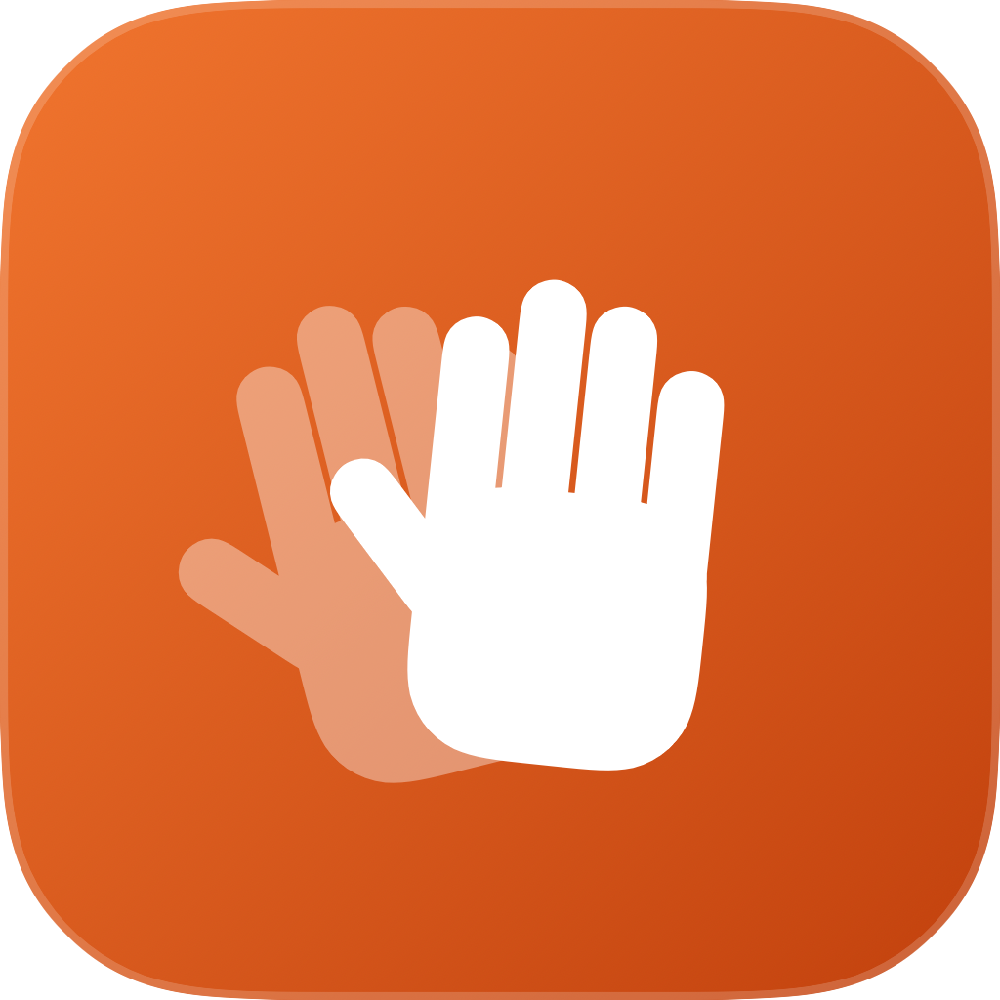
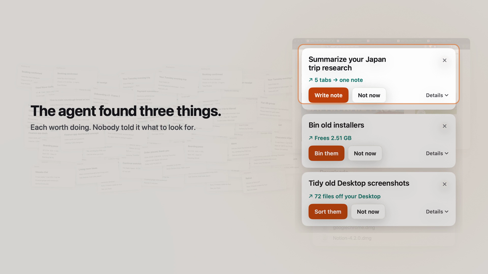

<p align="center"></p>

# Sparehand 1.0

**The proactive agent for your Mac.** Sparehand notices what needs doing while you work, asks once, then does it, the big jobs on a screen of its own that you can watch.

[](https://github.com/pulkitnagpal/sparehand/releases/download/v1.0.0/sparehand-1.0.mp4)

*Watch the 70-second film. Every window, card and note in it is from a real run.*

It lives in your menu bar, with a main window that lists what it found, what it did today (each with Undo) and what it has learned. Every few minutes it takes a quiet look at your Mac (your Desktop and Downloads, open tabs, apps, memory, disk) and offers at most three things, as small cards:

- **Sort 80 Desktop screenshots.** It reads each one and files it by what it shows: Travel, Receipts, Chats…
- **Bin old installers.** It frees 2.4 GB, and it's undoable.
- **Turn your trip tabs into a note.** It reads the pages and writes the note on its own invisible screen, which you can watch.

Nobody writes rules for any of these. Sparehand sees your Mac the way a helpful person would, and Claude decides what's worth offering. Code checks every plan against what's actually there before you see it.

- **Never acts without your tap.**
- **Undo anything it did:** files move back, tabs reopen, notes are deleted.
- **Your files never leave your Mac.** Only a short text snapshot is sent to Claude, with keys, tokens and passwords stripped first.
- **Learns you.** Approve something once and it handles the repeat on your Mac. Say "Never" and it stops offering.

## Install

Requirements:
- macOS 26 on Apple silicon
- the Command Line Tools (`xcode-select --install`)
- [uv](https://docs.astral.sh/uv/) (`brew install uv`), for the on-device model
- an Anthropic API key

```bash
git clone https://github.com/pulkitnagpal/sparehand.git
```
```bash
cd sparehand && ./scripts/install.sh
```

The first time, `install.sh` builds the app, puts it in `~/Applications`, and downloads the on-device model (about 2.5 GB). Then it opens Sparehand. On the Welcome screen:
1. Paste your API key.
2. Allow Screen Recording, which is used only to show you Sparehand's own screen. Yours is never recorded.
3. Click **Start Sparehand**.

macOS asks once before Sparehand controls Finder, Notes or your browser.

## How it works

1. **Look.** A snapshot of ordinary Mac state is taken on your Mac, with secrets redacted. Apple's on-device text recognition reads new screenshots.
2. **Screen.** A small model on your Mac (Qwen 4B, through MLX) checks whether anything is worth a closer look.
3. **Decide.** Claude gets the snapshot, a list of tools and what Sparehand knows about you, and proposes up to three plans.
4. **Check.** Code verifies every file, tab and app a plan names, and drops anything invented or repeated.
5. **Act.** On your tap, Sparehand does it itself, records every change for Undo, and learns the plan as a skill.

All decisions are logged on your Mac in `~/Library/Application Support/Sparehand/`.

## The demo film

`scripts/demo-setup.sh` builds a messy scene in a throwaway folder; the app's `--film` mode drives the real product through it and
captures its own windows; `scripts/video/make-film.sh` stages those captures into the film. Every card, plan and result in it comes from that real run.

## Develop

```bash
./scripts/test.sh
```
```bash
swift build && .build/debug/sparehand look --force
```

The second command looks once and prints every step of the decision. `scripts/demo-setup.sh` builds a messy demo scene in a throwaway folder, leaving your real files alone.

## License

MIT
